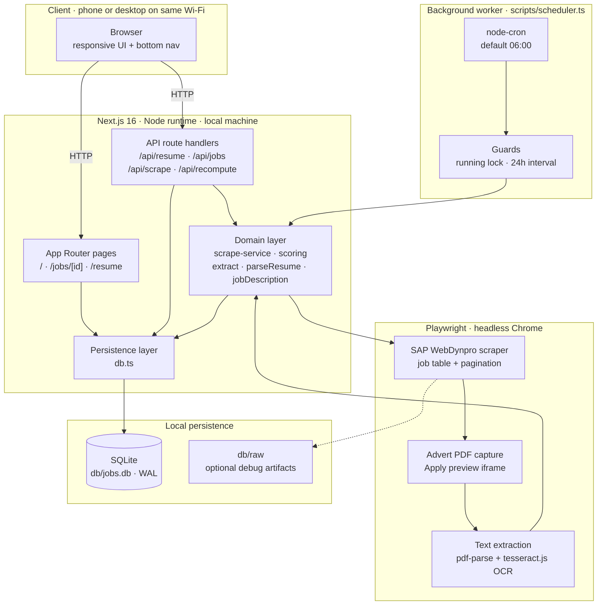
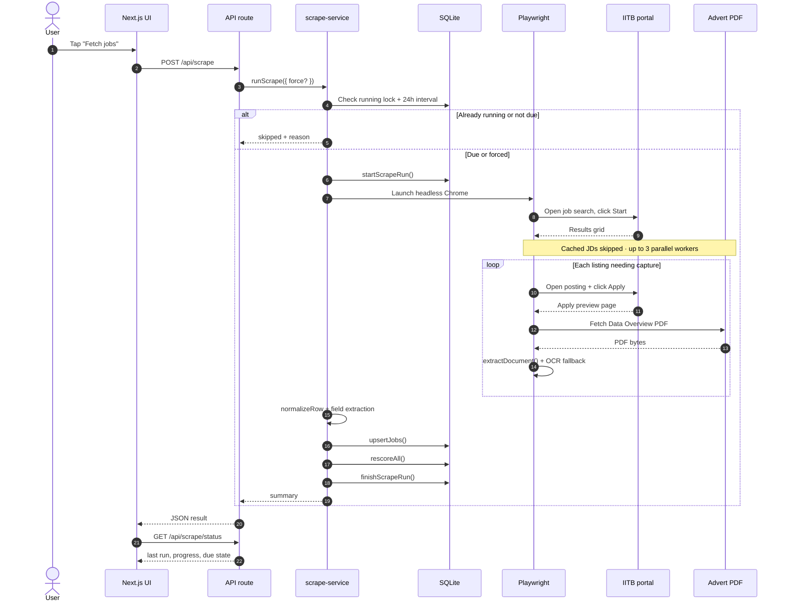
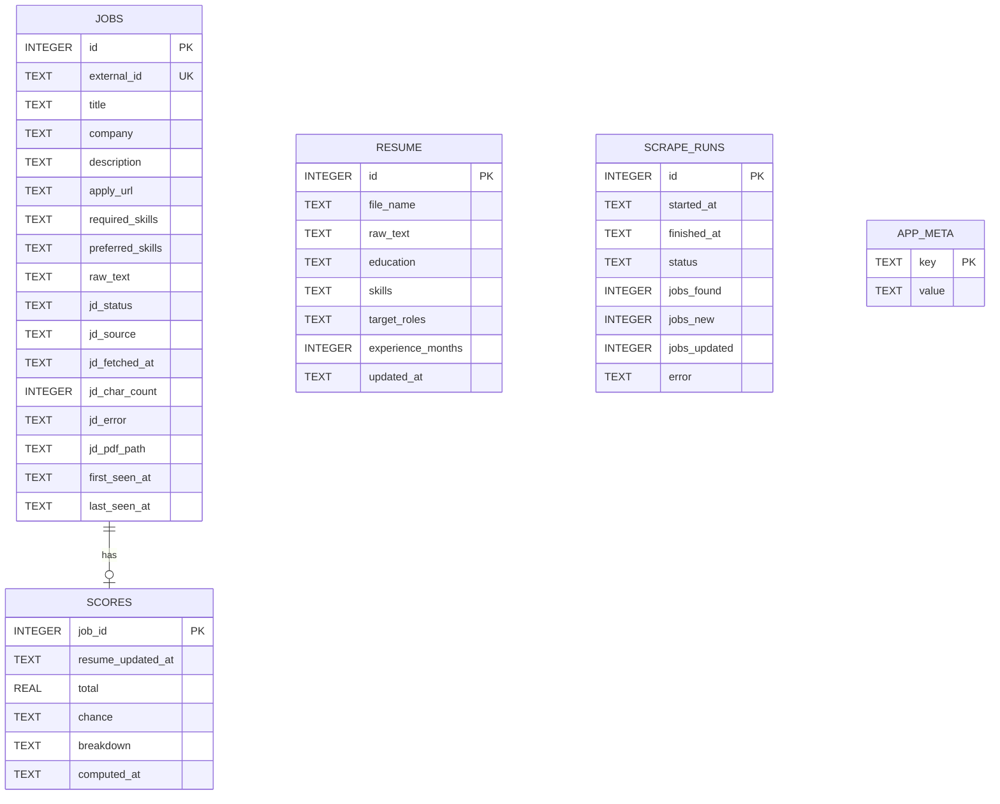

# Documentation

Technical reference for **IIT Bombay Job Match**: a local Next.js app that scrapes
the IIT Bombay career portal, stores postings in SQLite, and scores them against a
resume.

---

## 1. Architecture at a glance

```
Browser (Next.js UI)
   │
   ├─ /                    Dashboard: server-rendered score list, filters, status
   ├─ /resume              Upload + edit parsed profile
   └─ /jobs/[id]           Posting detail + score breakdown
   │
   ▼
Next.js API routes (Node runtime)
   ├─ POST /api/scrape           Trigger a fetch (force or interval-aware)
   ├─ GET  /api/scrape/status    Last run, due state, running state
   ├─ GET/POST/PATCH /api/resume Resume text extraction + profile edits
   ├─ GET  /api/jobs             List scored jobs
   ├─ GET  /api/jobs/[id]        One scored job
   └─ POST /api/recompute        Re-score all jobs against current resume
   │
   ▼
src/lib/*
   ├─ scraper.ts         Playwright scraping of the SAP portal
   ├─ scrape-service.ts  Orchestration, normalization, run bookkeeping
   ├─ extract.ts         Regex/heuristic field extraction
   ├─ scoring.ts         Deterministic scoring engine
   ├─ parseResume.ts     PDF/DOCX text extraction entry point
   ├─ pdfText.ts         pdf-parse + tesseract.js OCR fallback
   ├─ textNormalize.ts   Pure PDF/OCR text normalization helpers
   ├─ skills.ts          Skill dictionary + matching
   ├─ schedule.ts        Cron helpers
   ├─ db.ts              node:sqlite schema + queries
   └─ config.ts          Env-driven configuration
   │
   ▼
SQLite: db/jobs.db   (WAL mode)
Debug artifacts: db/raw/ (HTML snapshots, optional network capture)
```

The ASCII map above is the quick text view. The Mermaid diagram below adds the
process boundaries: the browser, the Next.js server, the separate scheduler
worker, Playwright, and the shared SQLite file.



The browser only talks to Next.js. SQLite is accessed server-side by pages, API
routes, and the scheduler. The scheduler is a separate OS process and shares the
same database file.

Background worker: `scripts/scheduler.ts` (node-cron) runs the same scrape service
daily. It is started together with the app via `npm run dev:all` / `npm run start:all`.

---

## 2. Data flow

1. **Scheduler or user** triggers a scrape.
2. `runScrape` checks whether a run is already active and whether the last
   successful run is older than `SCRAPE_MIN_INTERVAL_HOURS` (unless forced).
3. `scrapeJobs` launches Playwright, opens the portal, clicks **Start**, waits for
   the results grid, and extracts rows.
4. Unless disabled, missing/changed advert PDFs are captured in parallel. Cached
   descriptions are reused; low-quality or scanned pages fall back to local OCR
   (`tesseract.js`). See section 3.
5. `normalizeRow` turns raw rows into `JobInput` records, using the captured
   description when present and the listing metadata otherwise.
6. `upsertJobs` inserts new postings or updates existing ones (keyed by
   `externalId`, which is the portal reference code, e.g. `iitb:ircc/ext447/2026`).
7. If a resume exists, `rescoreAll` recomputes and stores a score for every job.
8. The run is recorded in `scrape_runs`; the UI reads status from there.

The sequence below shows the full scrape path, including the advert-PDF capture
inside the per-job loop.



---

## 3. Scraper internals (IIT Bombay portal)

The source is `https://ep.iitb.ac.in/jobsearch`, a SAP NetWeaver / WebDynpro ABAP
application (`erpprd_ECP_00`, `sap-client=300`). It is an institute HR recruitment
portal, not the student placement portal.

Key behaviours discovered during development:

- No login is required to **browse** vacancies.
- The results are empty until the **Start** button is pressed.
- SAP renders buttons as `<div ct="B" ...>` (often with class `lsButton`), not
  `<button>`.
- Job titles are anchors `<a ct="LN">` with an inner `span.lsLink__text`.
- Each job row has cells roughly like:
  `["", "Laboratory Assistant", "IRCC/EXT447/2026", "11.11.2026", "23.11.2026"]`
  → selection box, title, reference code, start date, last date.
- All current postings render on one page (no real pagination), but a conservative
  `clickNext` loop is kept as a safeguard.
- Non-job links are skipped: `User Help.`, `Click here to view Job Vacancies`,
  `Apply`, `Return to Search`, `Start`, `Reset`.

Extraction flow in `scrapeJobs`:

1. `page.goto(portalUrl)`, wait for network idle.
2. `clickStart` finds `[ct="B"]` whose text is exactly `Start`, clicks it, waits
   until a row contains a ref code matching `/EXT\d+\/\d{4}/`.
3. `extractJobRows` iterates `a[ct="LN"]`:
   - skips help/action links,
   - reads the ancestor `<tr>` cells,
   - finds the reference code (`EXT###/YYYY`, e.g. `Admin-II/EXT350/2026`),
   - takes the first two date-like cells as **start date** and **deadline**,
   - classifies institute staff vs project staff.
4. Rows are deduplicated by reference code and returned as `RawJobRow[]`.

### Detail capture (full advertisement PDF)

The full advertisement is public, but it is buried behind the Apply flow:

1. Select a posting by clicking its title link (`a[ct="LN"]`). This reveals an
   **Apply** button (`div[ct="B"].lsButton--active`).
2. Clicking Apply opens **two** popups:
   `hrrcf_a_posting_apply` (the advert preview) and `hrrcf_a_applwizard` (account
   registration). Block `**/hrrcf_a_applwizard**` at the Playwright context level
   so the preview page stays open and stable.
3. The preview page renders `iframe#WD2D[title="Data Overview"]` inside
   `#WD2D-ph`. The browser shows Chrome's PDF viewer there, but the iframe `src`
   points at a real PDF endpoint:
   `/sap/bc/bsp/sap/hrrcf_wd_dovru/application.do?...&sap-client=300`.
4. Fetch that `src` with Playwright's request context:
   ```ts
   context.request.get(pdfUrl, {
     headers: {
       Accept: "application/pdf",
       Referer: detailPage.url(),
     },
     timeout: 60_000,
   });
   ```
   Without `Accept: application/pdf` the server returns an HTML placeholder.
   With it, the response starts with `%PDF-` and contains the full advert.
5. Extract text with `extractDocument("job-description.pdf", body)`:
   - `pdf-parse` `getText()` with enforced line breaks and normalized spacing.
   - Pages with fewer than `OCR_MIN_CHARS_PER_PAGE` readable characters are
     rendered with `getScreenshot()` and OCR'd locally with `tesseract.js`.
   - Text is normalized (page markers, smart punctuation, line-break hyphenation).
6. Store the cleaned text in `detailText`/`jobs.description`; `applyUrl` is the
   preview page URL. Metadata records `jd_status`, `jd_source`
   (`native|ocr|mixed`), `jd_fetched_at`, `jd_char_count`, and `jd_error`.
7. If `SCRAPE_STORE_PDFS` is enabled, the PDF is saved under `db/jd/` so it can be
   re-extracted later with `npm run reextract`.

The first full capture of 26 postings takes about 2-3 minutes with the default
three parallel workers (down from ~5 minutes serial). Later runs reuse cached
descriptions and usually only fetch the listing. Each row is retried once if
the first attempt fails, which handles transient popup timing. There is no need
to register or log in.

---

## 4. Normalization

`normalizeRow` (`src/lib/scrape-service.ts`) produces a `JobInput`:

- `title` — from the row's title cell/link.
- `company` — `IIT Bombay` (set by the scraper).
- `location` — `Mumbai` (set by the scraper).
- `jobType` — category: `Institute Staff` or `Project Staff`.
- `deadline` — last date cell, normalized by `parseDeadline`.
- `description` — the captured advert PDF text (`detailText`) when available;
  otherwise composed public metadata:
  ```
  Category: Project Staff
  Reference code: IRCC/EXT447/2026
  Applications open: 11.11.2026
  Last date to apply: 23.11.2026
  ```
- `requiredSkills` / `preferredSkills` — inferred by `extract.ts` + `skills.ts`.
- `eligibleBranches`, `eligibleDegrees`, `minCgpa`, `graduationYears` — inferred
  from text (usually empty for this portal, which means "no restriction listed").
- `externalId` — `iitb:<lowercased reference code>`, with a SHA-1 fallback.
- `jdStatus` / `jdSource` — extraction state (`ok|ocr|empty|failed|missing`) and
  provenance (`native|ocr|mixed`), plus `jdFetchedAt`, `jdCharCount`, `jdError`,
  and optional `jdPdfPath`.

Date parsing accepts `dd.mm.yyyy`, `dd/mm/yyyy`, `dd-mm-yyyy`, and ISO dates.

---

## 5. Scoring

Implemented in `src/lib/scoring.ts`. All inputs are deterministic — no LLM calls,
no network.

### Weights

| Component | Weight |
| --- | --- |
| Skills | 0.50 |
| Role | 0.30 |
| Experience | 0.20 |

### Skills

- Must-have matches are weighted 2, nice-to-have 1.
- `score = earned / totalWeight * 100`.
- If the posting lists no skills, the skill score is a neutral **50**.

### Role

- Tokenize the job title; expand with role synonyms (`software ↔ developer ↔
  engineer`, `data ↔ analyst ↔ science`, etc.).
- Compare with tokens from target roles, skills, and projects.
- If the posting also lists skills, blend title overlap (60%) and skill overlap
  (40%); otherwise title overlap alone is used.

### Experience

- Parses phrases like "2 years of experience".
- Scores 100 when the requirement is met, otherwise proportional.
- With no stated requirement: 85 when you have experience, 70 when you don't.

### Eligibility gates

Checks performed: **Branch**, **Degree**, **CGPA/CPI**, **Graduation year**,
**Deadline**.

- An empty list means "no restriction listed" and passes.
- Deadline must not be in the past (24-hour grace).
- A failed gate caps the total at 25 and forces chance to **Low**.

### Bands

| Total | Chance |
| --- | --- |
| ≥ 72 | High |
| ≥ 52 | Medium |
| < 52 | Low |

Each score stores the full breakdown (component scores, matched/missing skills,
eligibility checks) so the UI can explain itself.

---

## 6. Database schema

SQLite file: `db/jobs.db` (override with `DATABASE_PATH`). WAL mode, foreign keys on.

| Table | Purpose |
| --- | --- |
| `resume` | Single row (`id = 1`): file name, raw text, parsed fields, skills, target roles, experience, projects, certifications, update time. |
| `jobs` | One row per posting, unique `external_id`; public fields, extracted eligibility, raw text, first/last seen timestamps. |
| `scores` | One row per job: total, chance, JSON breakdown, resume version, computed time. |
| `scrape_runs` | Audit log: started/finished, status (`running`, `success`, `error`), counts, error. |
| `app_meta` | Key/value metadata (e.g. last activity). |

Array fields are stored as JSON strings. `scores.job_id` cascades on job delete.

Relationship view:



- `resume` is a single-row table (`id = 1`).
- `scores.resume_updated_at` is a version stamp, not a foreign key.
- `app_meta` stores `last_success_at` and live scrape progress.
- Structured JD formatting is derived at render time from `jobs.description`; it is
  not stored separately.

Connection is cached on `globalThis` so Next.js dev hot-reload doesn't open a new
handle each time.

---

## 7. Scheduler

`scripts/scheduler.ts`:

- Validates `SCRAPE_CRON` (default `0 6 * * *`).
- With `node-cron`, runs `runScrape()` on schedule.
- Skips a run if the last success is younger than `SCRAPE_MIN_INTERVAL_HOURS`.
- Logs progress and runs in the foreground with the app (`dev:all` / `start:all`).
- A stale `running` run older than 30 minutes is ignored, so a crash won't block
  future runs.

Manual "Fetch now" always forces a run, regardless of the interval.

---

## 8. Resume parsing

`src/lib/parseResume.ts`:

- **PDF** via `pdf-parse` (`PDFParse` class).
- **DOCX** via `mammoth` (`extractRawText`).
- Heuristics derive name, email, phone, degree, branch, CGPA, graduation year,
  experience months, target roles, projects, certifications, and skills
  (dictionary-driven in `src/lib/skills.ts`).
- `extractEducation` walks the education section and records each qualification
  with its specialization, institution, year range, and score. Degrees are
  ranked (PhD > M.Phil > master's > bachelor's), and the highest one becomes the
  profile's `degree`; all entries are used for eligibility checks, so a B.Sc in
  IT still counts even when an MCA is the highest qualification.

Everything is editable in the UI, so heuristic mistakes can be fixed before
scoring.

---

## 9. API routes

| Route | Method | Notes |
| --- | --- | --- |
| `/api/scrape` | `POST` | Query `force`, `details`, `refreshDetails`. Returns summary or skip reason. |
| `/api/scrape/status` | `GET` | Last run, due state, running state, next schedule. Lightweight snapshot via `getStatusSnapshot()`. |
| `/api/resume` | `GET` / `POST` / `PATCH` | Read, upload (multipart), or update profile. Re-scores on change. |
| `/api/jobs` | `GET` | `q`, `branch`, `staff`, `sort` (`score`\|`deadline`\|`recent`), `limit`, `offset`. Returns `JobSummary` rows (~25 KB/page) plus `total`. Switch/refetch signal for the dashboard. |
| `/api/jobs/[id]` | `GET` | One job plus its score breakdown. |
| `/api/recompute` | `POST` | Re-score all jobs against the current resume. |

## 10. UI

- **Mobile-first.** The top nav collapses to a fixed bottom tab bar
  (`src/components/BottomNav.tsx`) below the `sm` breakpoint. Safe-area insets,
  16px inputs (prevents iOS zoom), and full-width primary actions are used
  throughout.
- **Dashboard** (`src/app/page.tsx` → `Dashboard.tsx`): `page.tsx` is a server
  component (`force-dynamic`) that renders the first 20 cards into the HTML, so
  the list paints with the document and CLS stays at 0. `Dashboard.tsx` takes
  that as `initialData`/`initialStatus`, skips the first filter fetch, keeps the
  current list mounted while refetching (with an “Updating results…” hint),
  paginates with `loadMore`, and pauses the 15 s status poll when the tab is
  hidden. Also contains the fetch button, “Refresh all JDs” action, live
  progress banner (`x/y` descriptions, cached/failed/OCR counts), run status,
  collapsible filters on mobile, and empty states prompting a resume upload.
- **Performance budget.** `JobCard` receives a `JobSummary` (no `description`),
  is memoised, sets `prefetch={false}`, and carries `content-visibility: auto`
  (`.job-card`). `ScoreGauge` is a masked CSS `conic-gradient` rather than SVG.
- **Resume** (`src/app/resume/page.tsx` → `ResumeEditor.tsx`): upload and edit the
  parsed profile.
- **Job detail** (`src/app/jobs/[id]/page.tsx`): posting metadata, score gauge,
  component breakdown, matched/missing skills, eligibility checks, and the full
  job description (natural height, wraps on mobile).
- Styling: Tailwind CSS v4 via `@tailwindcss/postcss`; global theme in
  `src/app/globals.css`.

### Browse from your phone (LAN)

```bash
npm run dev:all:lan     # or npm run start:all:lan
```

Find the computer's IPv4 address with `ipconfig`, then open
`http://<ip>:3000` on a phone connected to the same Wi-Fi. If the page does not
load, allow TCP port 3000 through Windows Firewall:

```powershell
netsh advfirewall firewall add rule name="JobMatch 3000" dir=in action=allow protocol=TCP localport=3000
```

### Measuring performance

Audit a **production build only** — `next dev` ships unminified React plus
dev-only instrumentation (≈3.6 MB JS) and inflates TBT roughly 4x.

```bash
npm run build
npm start            # serves on :3000
npm run perf         # 3 runs, mobile 393x852 @2.625 DPR, 4x CPU throttle
npm run perf -- http://localhost:3000/ 5 2   # URL, runs, throttle
```

`scripts/perf.mjs` drives installed Chrome through Playwright and prints FCP,
LCP, CLS, TBT and total JS bytes. It also writes `perf-report.json` (git-ignored).
Reference figures on the bundled dataset: TBT ≈277 ms, CLS 0.00, ~480 KB JS.

---

---

## 11. Limitations and gotchas

- **Advert PDFs vary.** Native text is preferred; pages with little or no text
  are rendered and OCR'd locally with `tesseract.js`. OCR is English-only by
  default and can still misread unusual fonts or page edges.
- **Capture time.** A first full capture of 26 postings takes about 2-3 minutes
  with three parallel workers. Later runs reuse cached JDs; use “Refresh all JDs”
  (or `--refresh-details`) to force a full re-download. OCR only runs for
  low-quality pages, so most adverts stay fast.
- **Institute staff vs project staff.** Classification is heuristic: `Registrar`
  and `Admin-*` reference codes are treated as institute staff; everything else
  as project staff.
- **Deadline churn.** The portal updates as postings open/close; the 24-hour
  interval keeps data fresh without hammering the server.
- **`node:sqlite` is experimental** and prints a warning. It is stable enough for
  this app and avoids native build steps.
- **Browser channel.** Defaults to installed Chrome. Set `PW_CHANNEL=msedge` to
  use Edge, or run `npx playwright install chromium` and clear the variable.

---

## 12. Troubleshooting

| Symptom | Fix |
| --- | --- |
| "Could not launch a browser" | Install Chrome/Edge, or run `npx playwright install chromium`. |
| Scrape finds 0 jobs | Portal layout changed. Run `npm run inspect` and update selectors in `src/lib/scraper.ts`. |
| Scores all look similar | Expected for title-only postings; add a resume with clear target roles/skills. |
| `ExperimentalWarning: SQLite` | Harmless Node warning for `node:sqlite`. |
| Scheduler didn't run | Check `SCRAPE_CRON`, confirm `npm run dev:all` is used, and check the 24-hour interval. |
| Build touched `tsconfig.json` | Next.js automatically updates `jsx` / typed-route includes. Expected. |

---

## 13. File map

```
src/
  app/
    api/scrape/route.ts
    api/scrape/status/route.ts
    api/resume/route.ts
    api/jobs/route.ts
    api/jobs/[id]/route.ts
    api/recompute/route.ts
    page.tsx
    resume/page.tsx
    jobs/[id]/page.tsx
    layout.tsx
    globals.css
  components/
    Dashboard.tsx
    JobCard.tsx
    ScoreGauge.tsx
    ResumeEditor.tsx
  lib/
    config.ts      types.ts      db.ts
    jobList.ts     status.ts     scrape-state.ts
    scraper.ts     scrape-service.ts
    extract.ts     skills.ts     scoring.ts
    parseResume.ts pdfText.ts    textNormalize.ts
    schedule.ts    scoring.test.ts textNormalize.test.ts
scripts/
  scrape.ts        scheduler.ts   inspect.ts
  reextract.ts     perf.mjs
README.md
DOCUMENTATION.md
```
